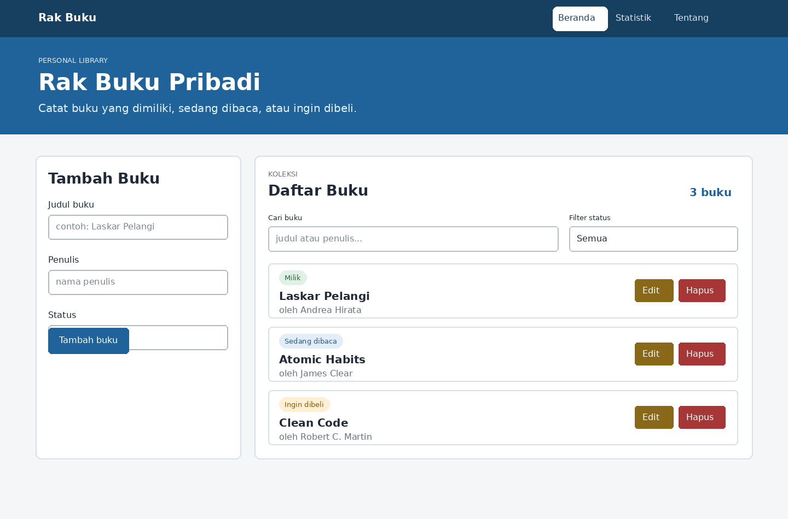
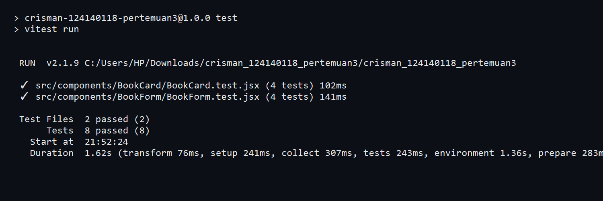

# Aplikasi Manajemen Buku Pribadi

Project ini dibuat untuk tugas praktikum PAW pertemuan 3, aplikasi ini digunakan untuk mencatat buku pribadi, data buku disimpan di localStorage sehingga tetap ada setelah halaman direfresh

## Fitur

- Menambah buku
- Mengedit buku
- Menghapus buku
- Mencari buku berdasarkan judul atau penulis
- Memfilter buku berdasarkan status
- Melihat statistik buku
- Menyimpan data di localStorage

## Cara Menjalankan

Buka folder project di VS Code, lalu jalankan perintah berikut

```bash
npm install
npm run dev
```

Buka alamat yang muncul di terminal, biasanya `http://localhost:5173`

## Tampilan Aplikasi



## Konsep React yang Digunakan

- Functional component dan props
- useState untuk menyimpan data sementara
- useEffect untuk menyimpan data ke localStorage
- React Router untuk halaman beranda dan statistik
- Context API untuk mengatur data buku
- Custom hook useLocalStorage dan useBookStats
- PropTypes untuk memeriksa tipe props
- Conditional rendering untuk menampilkan kondisi tertentu

## Testing

Testing dibuat dengan Vitest dan React Testing Library, terdapat 8 test untuk form dan data buku

Jalankan testing dengan perintah berikut

```bash
npm test
```


